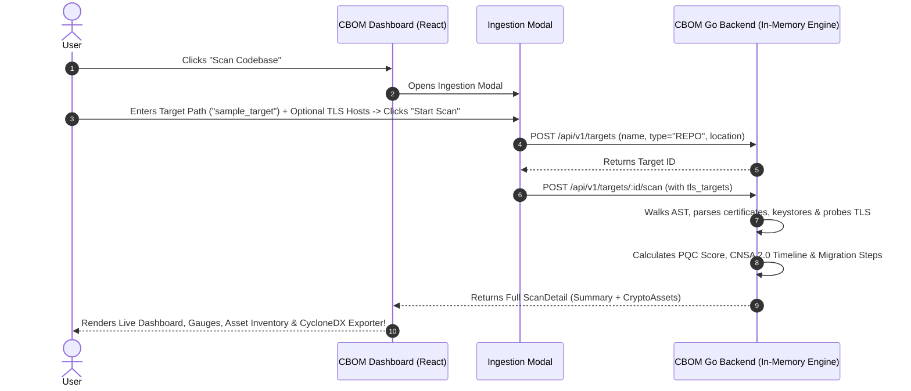

# 🛡️ QuantumVault CBOM Scanner 2.0

> **Enterprise-Grade Post-Quantum Cryptographic Bill of Materials (CBOM) & Risk Management Platform**  
> *Built with Go 1.22+, React + Vite Web Dashboard, Tree-Sitter AST, Embedded Gitleaks v8, Active Network & TLS Endpoint Probing, Zero-DB / In-Memory Engine, and CycloneDX 1.6 Exporter (JSON & XML)*

[](https://golang.org)
[](https://reactjs.org)
[](https://vitejs.dev)
[](https://csrc.nist.gov/projects/post-quantum-cryptography)
[](https://www.nsa.gov)
[](https://cyclonedx.org)
[](#-testing--verification)

---

## 📌 Table of Contents

- [Overview \& Vision](#-overview--vision)
- [Zero-DB / Pure In-Memory Architecture](#-zero-db--pure-in-memory-architecture)
- [System Architecture \& Workflow](#-system-architecture--workflow)
- [Key Features \& Capabilities](#-key-features--capabilities)
- [Active Network \& Live TLS Endpoint Scanning](#-active-network--live-tls-endpoint-scanning)
- [Local Directory Codebase Ingestion](#-local-directory-codebase-ingestion)
- [Environment Configuration (`.env`)](#-environment-configuration-env)
- [React Web Dashboard \& UI Features](#-react-web-dashboard--ui-features)
- [Directory \& File Structure](#-directory--file-structure)
- [NSA CNSA 2.0 Compliance Timelines](#-nsa-cnsa-20-compliance-timelines)
- [How to Run the Server \& Dashboard](#-how-to-run-the-server--dashboard)
- [Testing \& Verification](#-testing--verification)
- [License \& Security](#-license--security)

---

## 🔍 Overview & Vision

**QuantumVault CBOM Scanner 2.0** is an enterprise-grade Post-Quantum Cryptographic Bill of Materials (CBOM) platform. It provides automated cryptographic discovery across local source code ASTs, secrets, containers, X.509 certificates, Java/PKCS12 keystores, and live network endpoints.

It calculates a **NIST PQC Readiness Score (0-100)**, tracks **NSA CNSA 2.0 regulatory compliance deadlines**, aggregates call-site symbol dependencies, and exports standard **CycloneDX 1.6 CBOM** specifications in both **JSON** and **XML**.

```
┌─────────────────────────────────────────────────────────────────────────────────┐
│                           QUANTUMVAULT CBOM PLATFORM                            │
│                                                                                 │
│                          Local Codebase Directory Target                        │
│                                      │                                          │
│                                      ▼                                          │
│ ┌─────────────────────────────────────────────────────────────────────────────┐ │
│ │ 1. AST Engine │ 2. Git & Secrets │ 3. Syft Containers │ 4. TLS & Network    │ │
│ └────────────────────────────────────┬────────────────────────────────────────┘ │
│                                      ▼                                          │
│ ┌─────────────────────────────────────────────────────────────────────────────┐ │
│ │ 5. SymbolGraph Tracing & Scope Elevation (Prod 1.5x, Staging 0.7x, Test 0.3x)│ │
│ └────────────────────────────────────┬────────────────────────────────────────┘ │
│                                      ▼                                          │
│ ┌─────────────────────────────────────────────────────────────────────────────┐ │
│ │ 6. PQC Risk Score Engine & CNSA 2.0 Timeline Tagging                        │ │
│ └────────────────────────────────────┬────────────────────────────────────────┘ │
│                                      ▼                                          │
│ ┌────────────────────────────────────┴────────────────────────────────────────┐ │
│ │ 7. Live Dashboard Preview & CycloneDX 1.6 Exporter (JSON + XML)             │ │
│ └─────────────────────────────────────────────────────────────────────────────┘ │
└─────────────────────────────────────────────────────────────────────────────────┘
```

---

## ⚡ Zero-DB / Pure In-Memory Architecture

QuantumVault CBOM runs in **Zero-DB Mode**:
- 🚀 **Zero External Dependencies**: No MySQL, PostgreSQL, or SQLite setup required.
- ⚡ **Instant Execution**: The server starts up in milliseconds and holds scan results in high-performance, thread-safe memory storage.
- 🔄 **Ephemeral Scan Preview**: Scan any local repository -> preview the comprehensive findings live on the dashboard -> keep it in preview until the next scan -> export / download CycloneDX 1.6 JSON & XML directly.

---

## 🔁 System Architecture & End-to-End Workflow



---

## 🛠️ Key Features & Capabilities

### 1. 🌳 Tree-Sitter AST Syntax Parsing
- Deep Concrete Syntax Tree (CST/AST) parsing for **12+ Language Families**:
  - `JavaScript`, `TypeScript`, `Python`, `Go`, `Java`, `Kotlin`, `C/C++`, `C#`, `Rust`, `Ruby`, `PHP`, `Terraform`.
- Directly targets `call_expression` nodes, walking AST argument trees to extract multi-line parameters (e.g. `modulusLength: 1024`) across line boundaries with **zero false positives** on comments or string logs.

### 2. 🌐 SymbolGraph Call-Site Tracing & Scope Weight Elevation
- **Single-Asset Call-Site Aggregation**: SymbolGraph creates exactly 1 `CryptoAsset` per definition site, aggregating caller files into `CryptoAsset.Details` (e.g. `Consumed by controllers/auth.js:L45`).
- **Scope Elevation**: If a production file consumes a symbol defined in a utility file, the asset's `BusinessScope` and `ScopeWeight` automatically elevate to `PRODUCTION` (1.5x), ensuring high-risk callers boost visibility.

### 3. 🔐 Keystore Decryption & Weak Credential Detection
- Decrypts **PKCS#12** (`.p12`, `.pfx`) and **Java Keystores** (`.jks`) using `go-pkcs12` and `keystore-go/v4`.
- **Weak Password Gate**: Generates a **CRITICAL** risk finding if a keystore is protected by weak default passwords (`changeit`, `password`, `123456`).
- **Exact Bit-Size Measurement**: Measures actual public key bit lengths (`rsa.N.BitLen()`, `ecdsa.Curve.Params().BitSize`).

### 4. 🗝️ Secrets & Git Commit History Scanning
- Embedded **Gitleaks v8 engine** scanning in-memory files and raw content.
- **Git Commit History Traversal**: Runs `git log --all -p` to inspect deleted files, past commits, and historical exposed credentials in `.git`.
- **Token Redaction**: Redacts sensitive tokens in logs (`strings.ReplaceAll(output, token, "***REDACTED***")`).

### 5. 🐳 Container & Syft Image Scanner
- Syft CLI binary orchestrator parsing SBOM packages, assigning **CRITICAL** risk to EOL OpenSSL versions (`libssl1.1`).
- Static Dockerfile fallback parser with regex security gate preventing command injection.

### 6. 🌐 Active Network & Live TLS Endpoint Scanner
- **Active TLS Handshake Probe ([tls_scanner.go](file:///c:/CBOM/backend/internal/scanner/tls_scanner.go))**: Connects directly to host:port endpoints (e.g. `api.example.com:443`) via `crypto/tls` handshake.
- **Protocol & Cipher Suite Analysis**: Evaluates TLS version (TLS 1.0, 1.1, 1.2, 1.3) and cipher algorithms, flagging TLS 1.0/1.1 as **CRITICAL** and TLS 1.2 as **MEDIUM** risk.
- **X.509 Certificate Inspection**: Validates server certificate chains, expiry dates, and issuer authorities.

---

## 🌐 Active Network & Live TLS Endpoint Scanning

Users can pass live endpoints directly during ingestion via the Web UI Ingestion Modal:

1. In the **Ingestion Modal**, fill the optional **"Live TLS / Network Hosts"** field:
   ```
   api.example.com:443, db.example.com:8443
   ```
2. The scanner auto-discovers open TLS ports and performs active handshakes.
3. Live findings are displayed on the dashboard with dedicated **TLS/Network (Cyan)** badges.

---

## 📁 Local Directory Codebase Ingestion

Direct local filesystem scan for local repositories, microservice projects, or staging directories:
- Point to any relative path (e.g. `sample_target`) or absolute system path.
- Recursively parses source code, config files, certificates, keystores, and container definitions.

---

## ⚙️ Environment Configuration (`.env`)

The Go backend features an automatic `.env` loader in `pkg/config/config.go` (zero configuration needed by default).

### [.env.example](file:///c:/CBOM/.env.example)

```ini
# Server Port & CORS
PORT=8080
ALLOW_ORIGINS=*
```

---

## 🎨 React Web Dashboard & UI Features

- **Direct Ingestion Modal ([IngestionModal.jsx](file:///c:/CBOM/frontend/src/components/IngestionModal.jsx))**: Simple modal for Local Directories with optional **Live TLS Endpoints** input field (`api.example.com:443`).
- **Dedicated Scanner Breakdown Badges ([DashboardPage.jsx](file:///c:/CBOM/frontend/src/pages/DashboardPage.jsx))**:
  - 🟣 **Container Badge**: Container/Dockerfile & Syft SBOM findings.
  - 🔵 **TLS/Network Badge**: Active TLS handshake & cert findings.
  - 🔴 **Secrets Badge**: Leaked secrets & credentials in source code and git history.
- **CycloneDX 1.6 Exporter Modal ([CycloneDXExportModal.jsx](file:///c:/CBOM/frontend/src/components/CycloneDXExportModal.jsx))**: Live JSON & XML viewers (`?format=xml`) with 1-click **Copy to Clipboard** and **File Download**.
- **Interactive Asset Inventory ([AssetTable.jsx](file:///c:/CBOM/frontend/src/components/AssetTable.jsx))**: Multi-filter search by asset type, severity, and SymbolGraph consumer call sites.
- **Automated Migration Strategy ([MigrationPlannerPage.jsx](file:///c:/CBOM/frontend/src/pages/MigrationPlannerPage.jsx))**: Step-by-step PQC remediation playbooks mapping vulnerable assets to NIST ML-DSA & ML-KEM algorithms.
- **Centered Risk Gauge ([RiskGauge.jsx](file:///c:/CBOM/frontend/src/components/RiskGauge.jsx))**: Centered score overlay (`24 / 100`) inside responsive SVG ring.

---

## 📁 Directory & File Structure

```
c:\CBOM
├── .env                             # Optional Environment Config (PORT, ALLOW_ORIGINS)
├── .env.example                     # Environment Configuration Template
├── .gitignore                       # Git ignore rules (.env, build binaries, .pem keys)
├── README.md                        # Master Documentation
├── backend/
│   ├── cmd/
│   │   ├── scanner/main.go          # CLI Scanner Binary
│   │   └── server/main.go           # REST API Server Entry Point
│   ├── internal/
│   │   ├── controllers/
│   │   │   └── cbom_controller.go   # Scans, Targets & Migration Handlers (JSON + XML)
│   │   ├── models/models.go         # Core Data Models & CycloneDX Structs (JSON + XML)
│   │   ├── repository/
│   │   │   └── cbom_repository.go   # In-Memory High-Performance Storage (Zero-DB)
│   │   ├── risk/risk_engine.go      # Risk Score Engine & Remediation Playbooks
│   │   ├── scanner/
│   │   │   ├── scanner.go           # Core Scanner Orchestrator
│   │   │   ├── symbol_graph.go      # Symbol Call-Site Tracing & Scope Elevation
│   │   │   ├── container_scanner.go # Container & Syft Scanner
│   │   │   ├── secret_scanner.go    # Gitleaks History Scanner
│   │   │   ├── cert_scanner.go      # X.509 & Keystore Scanner
│   │   │   └── tls_scanner.go       # Active Multi-Port TLS Prober
│   ├── pkg/config/config.go         # Auto .env loader & Configuration Manager
│   └── rules.yaml                   # Crypto Detection Rules Definition
├── frontend/
│   ├── src/
│   │   ├── api/client.js            # REST API Client (Targets, Scans, TLS, CycloneDX)
│   │   ├── components/
│   │   │   ├── Navbar.jsx           # Responsive Navigation Header Bar
│   │   │   ├── IngestionModal.jsx   # Ingestion Modal (Local Directory + TLS)
│   │   │   ├── CycloneDXExportModal.jsx # CycloneDX JSON/XML Exporter Modal
│   │   │   ├── AssetTable.jsx       # Inventory Asset Table
│   │   │   ├── OverviewCards.jsx    # Summary Cards
│   │   │   └── RiskGauge.jsx        # Centered PQC Risk Gauge Component
│   │   ├── hooks/
│   │   │   ├── useCbomScan.js       # Scan & Target State Hook
│   │   │   └── useRiskMetrics.js    # Risk Metrics & Scanner Breakdown Calculator
│   │   └── pages/                   # Dashboard, Inventory, Risk & Migration Pages
│   ├── vite.config.js               # Vite Dev Server & API Proxy
│   └── package.json
└── sample_target/                   # Comprehensive Testbed Folder
```

---

## 🏛️ NSA CNSA 2.0 Compliance Timelines

| Category | Classical Algorithm | Target PQC Algorithm | NSA CNSA 2.0 Mandatory Deadline |
|---|---|---|---|
| **Software & Firmware Signing** | RSA-2048 / ECDSA | **ML-DSA-65 / ML-DSA-87** | **2025 (Begin) — 2030 (Mandatory)** |
| **Symmetric Key Encryption** | AES-128 | **AES-256** | **2026 (Begin) — 2030 (Mandatory)** |
| **Key Establishment & KEM** | ECDH / RSA Key Exchange | **ML-KEM-768 / ML-KEM-1024** | **2026 (Begin) — 2033 (Mandatory)** |
| **Web Browsers & TLS** | RSA / ECDSA Certificates | **ML-DSA-65 / Hybrid TLS** | **2025 (Begin) — 2033 (Mandatory)** |

---

## 💻 How to Run the Server & Dashboard

### Option A: 🐳 1-Command Docker Compose Deployment (Recommended)

Run the entire fullstack platform (Backend + Frontend Dashboard with Nginx) in Docker:

```powershell
cd c:\CBOM
docker compose up --build
```
- **Web Dashboard**: Open [http://localhost:3000](http://localhost:3000) in your browser.
- **REST API & Health**: [http://localhost:8080/api/v1/health](http://localhost:8080/api/v1/health)

---

### Option B: 🚀 Direct Local Development (No Docker Required)

#### Step 1: Start Backend REST API Server (Terminal 1)
```powershell
cd c:\CBOM\backend
go run ./cmd/server/main.go
```
*The Go server starts in Zero-DB / In-Memory mode instantly on `http://localhost:8080` (or `8081`).*

#### Step 2: Start Frontend Web Dashboard (Terminal 2)
```powershell
cd c:\CBOM\frontend
npm run dev
```
*The Vite Dev Server runs on `http://localhost:3000` with automatic API proxying.*

---

### Step 3: Run a Codebase Scan (`http://localhost:3000`)

1. Open `http://localhost:3000` in Edge or Chrome.
2. Click **"Scan Codebase"**.
3. Enter `sample_target` (or any local project path).
4. Discovered cryptographic components, NIST PQC score, and CycloneDX 1.6 JSON/XML immediately populate on the dashboard!

---

## 🧪 Testing & Verification

Run the full automated Go test suite:

```powershell
cd c:\CBOM\backend
go test -v ./...
```

### Verified Test Suite Breakdown:
- `TestSymbolGraphCallSiteAggregationAndScopeElevation`: Symbol call-site aggregation into `CryptoAsset.Details` and `ScopeWeight` elevation to `PRODUCTION` (1.5x).
- `TestContainerScannerSyftJSONParsing` & `TestContainerScannerDockerfileFallback`: Syft SBOM package parsing & static Dockerfile fallback parsing.
- `TestCycloneDXSpecCompliance`: CycloneDX 1.6 specification compliance (`pkg:generic/rsa@2048` PURLs, dynamic NIST levels, JSON & XML export).
- `TestTargetEntityManagement`: Target CRUD, auto-generated IDs, and scan in-memory management.

---

## 📄 License & Security

- **License**: Proprietary / Enterprise Security Tool.
- **Security Notice**: Never commit private keys or secrets into public repositories.
