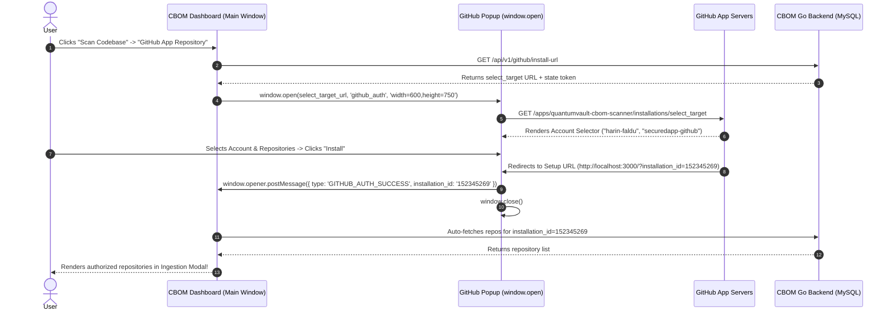

# 🛡️ QuantumVault CBOM Scanner 2.0

> **Enterprise-Grade Post-Quantum Cryptographic Bill of Materials (CBOM) & Risk Management Platform**  
> *Built with Go 1.22+, React + Vite Web Dashboard, Tree-Sitter AST, Embedded Gitleaks v8, Live AWS KMS SDK & Terraform IaC Drift Engine, Active Network & TLS Endpoint Probing, Vercel-Style GitHub App Popup Ingestion, MySQL Auto-Migrations, and CycloneDX 1.6 Exporter (JSON & XML)*

[](https://golang.org)
[](https://reactjs.org)
[](https://vitejs.dev)
[](https://aws.amazon.com)
[](https://csrc.nist.gov/projects/post-quantum-cryptography)
[](https://www.nsa.gov)
[](https://cyclonedx.org)
[](#-testing--verification)

---

## 📌 Table of Contents

- [Overview \& Vision](#-overview--vision)
- [Vercel-Style 1-Click GitHub App Authorization](#-vercel-style-1-click-github-app-authorization)
- [System Architecture \& Workflow](#-system-architecture--workflow)
- [Key Features \& Capabilities](#-key-features--capabilities)
- [Live AWS KMS SDK Discovery \& Terraform IaC Drift Engine](#-live-aws-kms-sdk-discovery--terraform-iac-drift-engine)
- [Active Network \& Live TLS Endpoint Scanning](#-active-network--live-tls-endpoint-scanning)
- [Dual Codebase Ingestion Modes](#-dual-codebase-ingestion-modes)
- [Environment Configuration (`.env`)](#-environment-configuration-env)
- [React Web Dashboard \& UI Features](#-react-web-dashboard--ui-features)
- [Directory \& File Structure](#-directory--file-structure)
- [NSA CNSA 2.0 Compliance Timelines](#-nsa-cnsa-20-compliance-timelines)
- [Getting Started \& 1-Minute GitHub Setup](#-getting-started--1-minute-github-setup)
- [How to Run the Server \& Dashboard](#-how-to-run-the-server--dashboard)
- [Testing \& Verification](#-testing--verification)
- [License \& Security](#-license--security)

---

## 🔍 Overview & Vision

**QuantumVault CBOM Scanner 2.0** is an enterprise-grade Post-Quantum Cryptographic Bill of Materials (CBOM) platform. It provides automated cryptographic discovery across source code ASTs, secrets, containers, live AWS KMS cloud keys, Terraform/CloudFormation IaC declarations, X.509 certificates, Java/PKCS12 keystores, and live network endpoints.

It calculates a **NIST PQC Readiness Score (0-100)**, tracks **NSA CNSA 2.0 regulatory compliance deadlines**, aggregates call-site symbol dependencies, performs **Live AWS KMS vs Terraform IaC Drift Detection**, and exports standard **CycloneDX 1.6 CBOM** specifications in both **JSON** and **XML**.

```
┌─────────────────────────────────────────────────────────────────────────────────┐
│                           QUANTUMVAULT CBOM PLATFORM                            │
│                                                                                 │
│  ┌─────────────────────────────────┐     ┌───────────────────────────────────┐  │
│  │ Mode 1: Local Codebase Directory│     │ Mode 2: Vercel GitHub Popup Ingest│  │
│  └────────────────┬────────────────┘     └─────────────────┬─────────────────┘  │
│                   │                                        │                    │
│                   └──────────────────┬─────────────────────┘                    │
│                                      ▼                                          │
│ ┌─────────────────────────────────────────────────────────────────────────────┐ │
│ │ 1. AST Engine │ 2. Git & Secrets │ 3. AWS KMS & IaC Drift │ 4. Syft │ 5. TLS │ │
│ └────────────────────────────────────┬────────────────────────────────────────┘ │
│                                      ▼                                          │
│ ┌─────────────────────────────────────────────────────────────────────────────┐ │
│ │ 6. SymbolGraph Tracing & Scope Elevation (Prod 1.5x, Staging 0.7x, Test 0.3x)│ │
│ └────────────────────────────────────┬────────────────────────────────────────┘ │
│                                      ▼                                          │
│ ┌─────────────────────────────────────────────────────────────────────────────┐ │
│ │ 7. PQC Risk Score Engine & CNSA 2.0 Timeline Tagging                        │ │
│ └────────────────────────────────────┬────────────────────────────────────────┘ │
│                                      ▼                                          │
│ ┌────────────────────────────────────┴────────────────────────────────────────┐ │
│ │ 8. Dashboard Badges & CycloneDX 1.6 Exporter (JSON + XML)                   │ │
│ └─────────────────────────────────────────────────────────────────────────────┘ │
└─────────────────────────────────────────────────────────────────────────────────┘
```

---

## 🚀 Vercel-Style 1-Click GitHub App Authorization

QuantumVault implements a modern, single-click **Vercel-style GitHub App Popup Authorization** experience:

1. **Target Account Selector (`select_target`)**:
   Backend constructs the official GitHub target selector URL:
   $$\text{https://github.com/apps/}\mathbf{<app-slug>}\text{/installations/}\mathbf{select\_target}\text{?state=...}$$
   GitHub automatically displays the **"Where do you want to install QuantumVault?"** screen, allowing users to pick between their **Personal Account** (e.g. `harin-faldu`) or any **Organization** (e.g. `securedapp-github`).

2. **Centered Popup Window (`window.open`)**:
   Clicking **"Install App on GitHub"** opens a centered `600x750px` popup window over Edge/Chrome. The main dashboard page remains active without reloading or losing state.

3. **Cross-Window Listener (`postMessage`) & Auto-Close**:
   Upon approving repositories, GitHub redirects the popup to `http://localhost:3000/?installation_id=XXXXX`. The popup extracts `installation_id`, posts a cross-window message `GITHUB_AUTH_SUCCESS` to the parent window, and **closes itself automatically (`window.close()`)**.

4. **Automatic Server Restart Storage Purge**:
   The Go backend generates a unique `ServerBootID` timestamp on startup. Whenever the server restarts (`go run ./cmd/server/main.go`), the React frontend detects the new instance ID and **empties `localStorage` automatically**, eliminating stale token errors.

---

## 🔁 System Architecture & End-to-End Workflow



---

## 🛠️ Key Features & Capabilities

### 1. 🌳 Tree-Sitter AST Syntax Parsing
- Deep Concrete Syntax Tree (CST/AST) parsing for **12+ Language Families**:
  - `JavaScript`, `TypeScript`, `Python`, `Go`, `Java`, `Kotlin`, `C/C++`, `C#`, `Rust`, `Ruby`, `PHP`, `Terraform`.
- Directly targets `call_expression` nodes, walking AST argument trees to extract multi-line parameters (e.g. `modulusLength: 1024`) across line boundaries with **zero false positives** on comments or string logs.

### 2. 🌐 SymbolGraph Call-Site Tracing & Scope Weight Elevation
- **Single-Asset Call-Site Aggregation**: SymbolGraph creates exactly 1 `CryptoAsset` per definition site, aggregating caller files into `CryptoAsset.Details` (e.g. `Consumed by controllers/auth.js:L45`).
- **Scope Elevation**: If a production file consumes a symbol defined in a utility file, the asset's `BusinessScope` and `ScopeWeight` automatically elevate to `PRODUCTION` (1.5x), ensuring high-risk callers boost visibility.

### 3. 🔐 Keystore Decryption & Weak Credential Detection
- Decrypts **PKCS#12** (`.p12`, `.pfx`) and **Java Keystores** (`.jks`) using `go-pkcs12` and `keystore-go/v4`.
- **Weak Password Gate**: Generates a **CRITICAL** risk finding if a keystore is protected by weak default passwords (`changeit`, `password`, `123456`).
- **Exact Bit-Size Measurement**: Measures actual public key bit lengths (`rsa.N.BitLen()`, `ecdsa.Curve.Params().BitSize`).

### 4. 🗝️ Secrets & Git Commit History Scanning
- Embedded **Gitleaks v8 engine** scanning in-memory files and raw content.
- **Git Commit History Traversal**: Runs `git log --all -p` to inspect deleted files, past commits, and historical exposed credentials in `.git`.
- **Token Redaction**: Redacts sensitive tokens in logs (`strings.ReplaceAll(output, token, "***REDACTED***")`).

### 5. ☁️ Live AWS KMS SDK Discovery & Terraform IaC Drift Engine
- **Live AWS API Enumeration ([aws_kms_live.go](file:///c:/CBOM/backend/internal/scanner/aws_kms_live.go))**: Discovers deployed KMS keys across 30+ AWS regions using a bounded worker pool (`maxConcurrentRegions = 5`), calling `kms:ListKeys`, `DescribeKey`, `GetKeyRotationStatus`, and `ListAliases`.
- **Enhanced IaC Parsing ([aws_kms_iac.go](file:///c:/CBOM/backend/internal/scanner/aws_kms_iac.go))**: Performs dual-pass parsing on `.tf` Terraform files, extracting `aws_kms_key` and `aws_kms_alias` resource blocks and resolving `target_key_id = aws_kms_key.payment_key.id` references back to local key names.
- **Alias-Based Drift Detector ([aws_kms_drift.go](file:///c:/CBOM/backend/internal/scanner/aws_kms_drift.go))**: Compares live AWS deployed keys against IaC declared keys by **Alias Name (`alias/payment-key`)**:
  - **Matched**: Keys deployed in AWS AND declared in `.tf` (Healthy state).
  - **Console-Only Drift**: Keys created manually via AWS Console, missing from Terraform code.
  - **IaC-Only Drift**: Keys declared in `.tf` code, but not yet deployed in AWS.
- **Instant Credential Guard (`hasAWSCredentials()`)**: Fast system credential check (< 0.01s instant fallback when no AWS credentials exist, preventing 70s IMDS metadata timeouts).

### 6. 🐳 Container & Syft Image Scanner
- Syft CLI binary orchestrator parsing SBOM packages, assigning **CRITICAL** risk to EOL OpenSSL versions (`libssl1.1`).
- Static Dockerfile fallback parser with regex security gate preventing command injection.

### 7. 🌐 Active Network & Live TLS Endpoint Scanner
- **Active TLS Handshake Probe ([tls_scanner.go](file:///c:/CBOM/backend/internal/scanner/tls_scanner.go))**: Connects directly to host:port endpoints (e.g. `api.example.com:443`) via `crypto/tls` handshake.
- **Protocol & Cipher Suite Analysis**: Evaluates TLS version (TLS 1.0, 1.1, 1.2, 1.3) and cipher algorithms, flagging TLS 1.0/1.1 as **CRITICAL** and TLS 1.2 as **MEDIUM** risk.
- **X.509 Certificate Inspection**: Validates server certificate chains, expiry dates, and issuer authorities.

---

## ☁️ Live AWS KMS SDK Discovery & Terraform IaC Drift Engine

```
┌────────────────────────────────────────────────────────────────────────┐
│                   DUAL AWS KMS DISCOVERY & DRIFT DETECTOR              │
│                                                                        │
│   [Live AWS API — bounded worker pool, one goroutine per region]       │
│   1. ec2.DescribeRegions (dynamic) → fallback to static list           │
│   2. Per region: kms.ListKeysPaginator → all KeyIds                    │
│   3. Per key: DescribeKey + GetKeyRotationStatus (AccessDenied-safe)   │
│   4. ListAliases → build KeyId → AliasName map                         │
│                       │                                                │
│   [Offline IaC Scanner — unchanged trigger, deeper parsing]            │
│   1. Parse aws_kms_key blocks (local resource name → attributes)       │
│   2. Parse aws_kms_alias blocks SEPARATELY, resolve target_key_id      │
│      back to the aws_kms_key local name it references                 │
│   3. Produces: alias name → declared key attributes                    │
│                       │                                                │
│                       ▼                                                │
│              MATCH BY ALIAS NAME ("alias/payment-key")                 │
│                       │                                                │
│                       ▼                                                │
│   • Matched: live key + IaC declaration both have this alias           │
│   • Console-only drift: live key exists, no IaC alias matches it       │
│   • IaC-only drift: alias declared in .tf, no live key has it yet      │
└────────────────────────────────────────────────────────────────────────┘
```

### IAM Permissions Required (Least Privilege Policy)

To run Live AWS KMS Discovery, create an IAM Role/User with this policy:

```json
{
  "Version": "2012-10-17",
  "Statement": [
    {
      "Effect": "Allow",
      "Action": [
        "kms:ListKeys",
        "kms:DescribeKey",
        "kms:GetKeyRotationStatus",
        "kms:ListAliases",
        "ec2:DescribeRegions"
      ],
      "Resource": "*"
    }
  ]
}
```

---

## 🌐 Active Network & Live TLS Endpoint Scanning

Users can pass live endpoints directly during ingestion via the Web UI Ingestion Modal:

1. In the **Local Directory Codebase** tab, fill the optional **"Live Hosts to Scan (Optional, comma-separated)"** field:
   ```
   api.example.com:443, db.example.com:8443
   ```
2. The scanner auto-discovers open TLS ports and performs active handshakes.
3. Live findings are displayed on the dashboard with dedicated **TLS/Network (Cyan)** badges.

---

## ⚡ Dual Codebase Ingestion Modes

| Mode | Target Type | Backend Method | Description |
|---|---|---|---|
| **Mode 1: Local Codebase** | `TargetTypeRepo` (`REPO`) | `s.scanner.ScanDirectory(dir, scanID)` | Direct local filesystem scan for local codebases or staging directories. |
| **Mode 2: Vercel GitHub App** | `TargetTypeGitHubRepo` (`GITHUB_REPO`) | `github.CloneRepository` + `s.scanner.ScanDirectory(tempDir, scanID)` | Remote Vercel-style 1-click GitHub App popup ingestion with ephemeral `git clone` and auto-cleanup. |

---

## ⚙️ Environment Configuration (`.env`)

The Go backend features an automatic line-by-line `.env` loader in `pkg/config/config.go`.

### 1. [.env.example](file:///c:/CBOM/.env.example) *(Committed to Git as template)*
Template file containing documented environment placeholders:

```ini
# Server Port & CORS
PORT=8080
ALLOW_ORIGINS=*

# Database Connection (MySQL)
DB_DRIVER=mysql
DB_HOST=127.0.0.1
DB_PORT=3306
DB_USER=root
DB_PASSWORD=your_db_password_here
DB_NAME=qv_cbom

# GitHub App Integration
GITHUB_APP_ID=your_github_app_id_here
GITHUB_APP_SLUG=your-github-app-slug-here
GITHUB_PRIVATE_KEY_PATH=/path/to/your-github-app-private-key.pem
```

### 2. [.env](file:///c:/CBOM/.env) *(Ignored by Git for security)*
Copy `.env.example` to `.env` in the root folder and add your local credentials:

```powershell
cp .env.example .env
```

---

## 🎨 React Web Dashboard & UI Features

- **Vercel-Style Ingestion Modal ([IngestionModal.jsx](file:///c:/CBOM/frontend/src/components/IngestionModal.jsx))**: Popup authorization modal for Local Directories & Remote GitHub App Repositories with optional **Live TLS Endpoints** input field (`api.example.com:443`).
- **Dedicated Scanner Breakdown Badges ([DashboardPage.jsx](file:///c:/CBOM/frontend/src/pages/DashboardPage.jsx))**:
  - 🟡 **Cloud KMS Badge**: Discovered KMS keys (Live + IaC + Drift).
  - 🟣 **Container Badge**: Container/Dockerfile & Syft SBOM findings.
  - 🔵 **TLS/Network Badge**: Active TLS handshake & cert findings.
  - 🔴 **Secrets Badge**: Leaked secrets & credentials in source code and git history.
- **CycloneDX 1.6 Exporter Modal ([CycloneDXExportModal.jsx](file:///c:/CBOM/frontend/src/components/CycloneDXExportModal.jsx))**: Live JSON & XML viewers (`?format=xml`) with 1-click **Copy to Clipboard** and **File Download**.
- **Interactive Asset Inventory ([AssetTable.jsx](file:///c:/CBOM/frontend/src/components/AssetTable.jsx))**: Multi-filter search by asset type, severity, and SymbolGraph consumer call sites.
- **Automated Migration Strategy ([MigrationPlannerPage.jsx](file:///c:/CBOM/frontend/src/pages/MigrationPlannerPage.jsx))**: Step-by-step PQC remediation playbooks mapping vulnerable assets to NIST ML-DSA & ML-KEM algorithms.
- **Centered Risk Gauge ([RiskGauge.jsx](file:///c:/CBOM/frontend/src/components/RiskGauge.jsx))**: Centered score overlay (`24 / 100`) inside responsive SVG ring.

---

## 📁 Directory & File Structure

```
c:\CBOM
├── .env                             # Active Local Environment Configuration (Ignored)
├── .env.example                     # Environment Configuration Template
├── .gitignore                       # Git ignore rules (.env, build binaries, .pem keys)
├── README.md                        # Master Documentation
├── backend/
│   ├── cmd/
│   │   ├── scanner/main.go          # CLI Scanner Binary
│   │   └── server/main.go           # REST API Server Entry Point
│   ├── internal/
│   │   ├── controllers/
│   │   │   ├── cbom_controller.go   # Scans, Targets & Migration Handlers (JSON + XML)
│   │   │   └── github_controller.go # Vercel-style select_target & Repos Handler
│   │   ├── github/
│   │   │   ├── auth.go              # RS256 JWT & Token Exchange
│   │   │   ├── client.go            # Installation Repos API
│   │   │   └── clone.go             # Ephemeral Git Clone & Redaction
│   │   ├── models/models.go         # Core Data Models & CycloneDX Structs (JSON + XML)
│   │   ├── repository/
│   │   │   └── cbom_repository.go   # MySQL (Auto Database Creation) & Memory Storage
│   │   ├── risk/risk_engine.go      # Risk Score Engine & Remediation Playbooks
│   │   ├── scanner/
│   │   │   ├── scanner.go           # Core Scanner Orchestrator
│   │   │   ├── symbol_graph.go      # Symbol Call-Site Tracing & Scope Elevation
│   │   │   ├── aws_kms_scanner.go   # Live AWS KMS & IaC Scanner Orchestrator
│   │   │   ├── aws_kms_live.go      # Live AWS SDK v2 Key Enumeration
│   │   │   ├── aws_kms_iac.go       # Terraform .tf Key & Alias Resolution Parser
│   │   │   ├── aws_kms_drift.go     # Alias-Based Drift Detector Engine
│   │   │   ├── aws_regions.go       # Dynamic AWS Region Discovery
│   │   │   ├── container_scanner.go # Container & Syft Scanner
│   │   │   ├── secret_scanner.go    # Gitleaks History Scanner
│   │   │   ├── cert_scanner.go      # X.509 & Keystore Scanner
│   │   │   └── tls_scanner.go       # Active Multi-Port TLS Prober
│   │   └── utils/secretbox.go       # AES-256-GCM Secret Encryption Box
│   ├── pkg/config/config.go         # Auto .env loader & Configuration Manager
│   └── rules.yaml                   # Crypto Detection Rules Definition
├── frontend/
│   ├── src/
│   │   ├── api/client.js            # REST API Client (Targets, Scans, TLS, CycloneDX)
│   │   ├── components/
│   │   │   ├── Navbar.jsx           # Responsive Navigation Header Bar
│   │   │   ├── IngestionModal.jsx   # Ingestion Modal (Local + TLS + Vercel GitHub Popup)
│   │   │   ├── CycloneDXExportModal.jsx # CycloneDX JSON/XML Exporter Modal
│   │   │   ├── AssetTable.jsx       # Inventory Asset Table
│   │   │   ├── OverviewCards.jsx    # Summary Cards
│   │   │   └── RiskGauge.jsx        # Centered PQC Risk Gauge Component
│   │   ├── hooks/
│   │   │   ├── useCbomScan.js       # Scan, Target & Popup Message State Hook
│   │   │   └── useRiskMetrics.js    # Risk Metrics & Scanner Breakdown Calculator
│   │   └── pages/                   # Dashboard, Inventory, Risk & Migration Pages
│   ├── vite.config.js               # Vite Dev Server & API Proxy
│   └── package.json
└── sample_target/                   # Comprehensive Testbed Folder
```

---

## 🏛️ NSA CNSA 2.0 Compliance Timelines

| Category | Classical Algorithm | Target PQC Algorithm | NSA CNSA 2.0 Mandatory Deadline |
|---|---|---|---|
| **Software & Firmware Signing** | RSA-2048 / ECDSA | **ML-DSA-65 / ML-DSA-87** | **2025 (Begin) — 2030 (Mandatory)** |
| **Symmetric Key Encryption** | AES-128 | **AES-256** | **2026 (Begin) — 2030 (Mandatory)** |
| **Key Establishment & KEM** | ECDH / RSA Key Exchange | **ML-KEM-768 / ML-KEM-1024** | **2026 (Begin) — 2033 (Mandatory)** |
| **Web Browsers & TLS** | RSA / ECDSA Certificates | **ML-DSA-65 / Hybrid TLS** | **2025 (Begin) — 2033 (Mandatory)** |

---

## ⚙️ Getting Started & 1-Minute GitHub Setup

### 1. Setup URL Configuration (Owner One-Time Setup)

To ensure GitHub knows where to redirect after popup authorization:

1. Open your GitHub App settings: [https://github.com/settings/apps](https://github.com/settings/apps) → Click your app (**QuantumVault-CBOM-Scanner**).
2. Scroll down to **"Setup URL (Optional)"**.
3. Enter: `http://localhost:3000/`
4. Click **Save Changes**.

---

## 💻 How to Run the Server & Dashboard

### Step 1: Create `.env` Configuration File

Copy `.env.example` to `.env` in the root folder:

```powershell
cp .env.example .env
```

Ensure your GitHub App ID, Slug, and Private Key Path are set in `.env`:
```ini
GITHUB_APP_ID=4534008
GITHUB_APP_SLUG=quantumvault-cbom-scanner
GITHUB_PRIVATE_KEY_PATH=C:\Users\harin\Downloads\quantumvault-cbom-scanner.2026-08-08.private-key.pem
```

---

### Step 2: Start Backend REST API Server (Terminal 1)

```powershell
cd c:\CBOM\backend
go run ./cmd/server/main.go
```
*The Go server connects to MySQL (auto-creates `qv_cbom` DB and tables) and runs on `http://localhost:8080` (or `8081`).*

---

### Step 3: Start Frontend Web Dashboard (Terminal 2)

```powershell
cd c:\CBOM\frontend
npm run dev
```
*The Vite Dev Server runs on `http://localhost:3000` with automatic API proxying.*

---

### Step 4: Test Vercel-Style Ingestion Flow (`http://localhost:3000`)

1. Open `http://localhost:3000` in Edge or Chrome.
2. Click **"Scan Codebase"** → Select **"GitHub App Repository"** tab.
3. Click the green **"Install App on GitHub"** button.
4. A centered `600x750px` popup window opens displaying GitHub's official **"Where do you want to install QuantumVault?"** account selector.
5. Pick your Personal Account (`harin-faldu`) or Organization (`securedapp-github`), select repositories, and click **"Install"**.
6. The popup window auto-closes (`window.close()`) and all authorized repositories immediately populate in the CBOM dashboard!

---

## 🧪 Testing & Verification

Run the full automated Go test suite:

```powershell
cd c:\CBOM\backend
go test -v ./...
```

### Verified Test Suite Breakdown:
- `TestGenerateAppJWT` & `TestGetInstallationTokenValidation`: RS256 JWT signing, 9-min expiry window, and Installation Access Token exchange error handling.
- `TestTokenScrubbingOnCloneFailure`: Verifies tokens are redacted (`***REDACTED***`) from git CLI error output.
- `TestLocalGitCloneAndHistorySecretDetection`: Ephemeral git clone history secret scanning against committed & deleted secrets.
- `TestSecretBoxEncryptionRoundtrip`: AES-256-GCM secret box encryption/decryption for GitHub App RSA `.pem` private keys.
- `TestSymbolGraphCallSiteAggregationAndScopeElevation`: Symbol call-site aggregation into `CryptoAsset.Details` and `ScopeWeight` elevation to `PRODUCTION` (1.5x).
- `TestAWSKMSScannerIaCFallback`: Fast fallback to IaC-only when no AWS credentials exist (`hasAWSCredentials()`).
- `TestParseTerraformKMSBlocks`: Parses `.tf` Terraform files, extracting `aws_kms_key` and resolving `aws_kms_alias` `target_key_id` references.
- `TestDetectKMSDrift`: Evaluates live AWS KMS findings against Terraform declarations by alias name (Matched, Console-Only Drift, IaC-Only Drift).
- `TestContainerScannerSyftJSONParsing` & `TestContainerScannerDockerfileFallback`: Syft SBOM package parsing & static Dockerfile fallback parsing.
- `TestCycloneDXSpecCompliance`: CycloneDX 1.6 specification compliance (`pkg:generic/rsa@2048` PURLs, dynamic NIST levels, JSON & XML export).
- `TestTargetEntityManagement`: Persistent Target CRUD, auto-generated IDs, and scan history.

---

## 📄 License & Security

- **License**: Proprietary / Enterprise Security Tool.
- **Security Notice**: Never commit RSA `.pem` private keys or AWS secret access keys into public repositories. Use `.env` file or environment variables (`GITHUB_PRIVATE_KEY_PATH`, `MASTER_KEY`) for secure key management.
