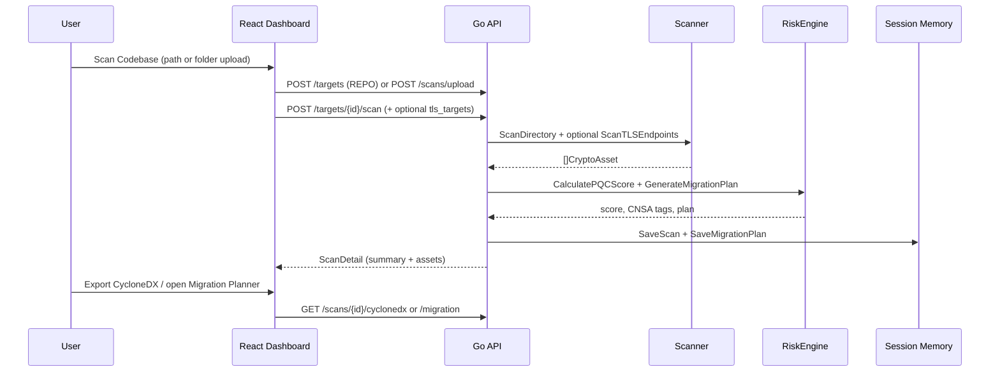
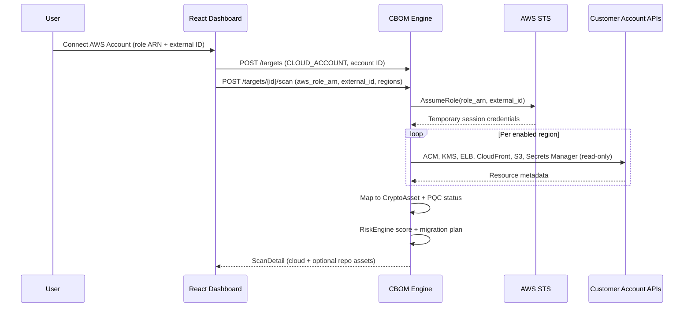

# PQ-Sentinel CBOM 2.0 — Platform Guide (Cryptographic / Quantum Bill of Materials)

**Document purpose:** Explain what the CBOM platform is, how it works end-to-end, what it can discover (source code, containers, TLS, and **AWS accounts via IAM role**), how it drives **Post-Quantum Cryptography (PQC) migration**, and how it relates to a **QBOM** (Quantum Bill of Materials) view of your estate.

**Product name:** PQ-Sentinel CBOM Scanner 2.0  
**Engine version:** 2.0.0 (see `GET /api/v1/health`)  
**Related quick start:** [README.md](../README.md), [DEPLOY.md](../DEPLOY.md)

---

## Table of contents

1. [Executive summary](#1-executive-summary)
2. [CBOM vs QBOM — terminology](#2-cbom-vs-qbom--terminology)
3. [Why this platform exists (PQC migration context)](#3-why-this-platform-exists-pqc-migration-context)
4. [High-level architecture](#4-high-level-architecture)
5. [Core data model](#5-core-data-model)
6. [End-to-end scan workflow](#6-end-to-end-scan-workflow)
7. [Discovery engines (what gets scanned and how)](#7-discovery-engines-what-gets-scanned-and-how)
8. [Rules engine (`rules.yaml`)](#8-rules-engine-rulesyaml)
9. [Symbol graph and business scope weighting](#9-symbol-graph-and-business-scope-weighting)
10. [Risk engine and PQC readiness score](#10-risk-engine-and-pqc-readiness-score)
11. [Migration planner (remediation playbooks)](#11-migration-planner-remediation-playbooks)
12. [CycloneDX 1.6 export (machine-readable CBOM)](#12-cyclonedx-16-export-machine-readable-cbom)
13. [REST API reference](#13-rest-api-reference)
14. [Web dashboard and user workflows](#14-web-dashboard-and-user-workflows)
15. [CLI scanner](#15-cli-scanner)
16. [Security, ingestion, and multi-tenant sessions](#16-security-ingestion-and-multi-tenant-sessions)
17. [Deployment topologies](#17-deployment-topologies)
18. [Using CBOM output for a PQC migration program](#18-using-cbom-output-for-a-pqc-migration-program)
19. [Standards and compliance mapping](#19-standards-and-compliance-mapping)
20. [AWS Cloud Scanner (IAM role)](#20-aws-cloud-scanner-iam-role)
21. [Current limitations and non-goals](#21-current-limitations-and-non-goals)
22. [Extension points for operators and developers](#22-extension-points-for-operators-and-developers)

---

## 1. Executive summary

**PQ-Sentinel CBOM** is a **cryptographic discovery and PQC readiness platform**. It ingests a **target** (local repository path, uploaded project folder, live TLS host, or **AWS account via cross-account IAM role**), runs multiple specialized scanners, and produces:

| Output | Description |
|--------|-------------|
| **Inventory** | Every discovered `CryptoAsset` (algorithms, certs, protocols, libraries, secrets, keystores, **AWS KMS/ACM/TLS**) with file/line, network, or `aws:…` location |
| **PQC classification** | `VULNERABLE`, `HYBRID_TRANSITIONAL`, or `QUANTUM_SAFE` per asset |
| **Risk tier** | `CRITICAL` → `SAFE` with human-readable rationale |
| **PQC Readiness Score** | Weighted 0–100 score (higher = more quantum-ready) |
| **CNSA 2.0 hints** | Per-asset compliance status and deadline buckets |
| **Migration plan** | Ordered remediation steps with suggested NIST PQC replacements |
| **CycloneDX 1.6 CBOM** | JSON or XML export for SBOM/CBOM pipelines |

Operationally, treat the product as a **QBOM-oriented system**: it answers *“Where is classical crypto in my stack, what breaks under quantum threat models, and what should I migrate to first?”* — not merely *“list every `crypto` import.”*

**Storage model today:** **Zero-DB / in-memory** per browser session (optional `score-history.json` on disk for CLI trend). No PostgreSQL is required. **AWS scans** need network reachability to STS and regional AWS APIs from the CBOM engine host.

---

## 2. CBOM vs QBOM — terminology

| Term | Meaning in industry | Meaning in PQ-Sentinel |
|------|---------------------|-------------------------|
| **CBOM** | [CycloneDX Cryptographic Bill of Materials](https://cyclonedx.org/capabilities/cbom/) — structured inventory of crypto assets | Primary export format (`cyclonedx` 1.6) and dashboard branding |
| **QBOM** | **Quantum Bill of Materials** — inventory annotated for quantum risk and PQC replacement | **Functional lens** on the same scan: `pqc_status`, `pqc_replacement`, readiness score, migration steps, CNSA timelines |
| **SBOM** | Software Bill of Materials (packages) | Partial overlap via **Syft/container** scanning (OpenSSL and crypto-related packages) |

Every scan is simultaneously:

1. A **CBOM** (exportable CycloneDX components with `cryptographic-asset` types), and  
2. A **QBOM-style assessment** (PQC status, replacements, weighted score, migration playbook).

---

## 3. Why this platform exists (PQC migration context)

### 3.1 Threat model (simplified)

- **Shor’s algorithm** (future cryptographically relevant quantum computers) breaks widely deployed **public-key** schemes: RSA, finite-field DH, ECDH, ECDSA, DSA at practical key sizes.
- **Grover’s algorithm** halves effective security of **symmetric** keys and hash outputs — e.g. AES-128 and SHA-256 remain usable with appropriate margin; AES-256 and SHA-256/384 are typically treated as PQC-safe for symmetric/hashing roles.
- **Harvest now, decrypt later (HNDL):** Adversaries may store encrypted traffic today and decrypt once quantum breaks classical key exchange — motivating **TLS**, **KEM**, and **long-lived secrets** review even before quantum hardware exists.

### 3.2 What migration programs need

1. **Discovery** — crypto in code, configs, certs, containers, live endpoints, and **AWS-managed crypto** (KMS, ACM, ELB/CloudFront TLS policies, S3 encryption, Secrets Manager metadata).  
2. **Prioritization** — production paths, critical algorithms, weak key sizes, expired cert chains, and internet-facing cloud TLS.  
3. **Standards alignment** — NIST PQC (ML-KEM, ML-DSA, SLH-DSA) and policy timelines such as **NSA CNSA 2.0**.  
4. **Actionable output** — replacement algorithm per finding, export for GRC/SIEM/ticketing, trend over time.

CBOM 2.0 implements (1)–(4) across **repo / upload / TLS / AWS CLOUD_ACCOUNT** targets in a **single unified scan and PQC score** (see [Section 20](#20-aws-cloud-scanner-iam-role)).

---

## 4. High-level architecture

```
┌──────────────────────────────────────────────────────────────────────────────┐
│                         CLIENTS                                               │
│  React Dashboard (port 3000)  │  CLI (cmd/scanner)  │  HTTP API consumers    │
└───────────────────────────────┬──────────────────────────────────────────────┘
                                │  REST + X-Session-ID
                                ▼
┌──────────────────────────────────────────────────────────────────────────────┐
│  Go API Server (cmd/server) — PQ-Sentinel CBOM Engine 2.0                    │
│  ┌─────────────┐  ┌──────────────┐  ┌─────────────┐  ┌──────────────────────┐ │
│  │ Controllers │→ │ CBOMService  │→ │ SessionStore│→ │ MemoryRepository     │ │
│  │ (HTTP)      │  │ orchestration│  │ (per client)│  │ targets/scans/plans  │ │
│  └─────────────┘  └──────┬───────┘  └─────────────┘  └──────────────────────┘ │
│                            │                                                    │
│                            ▼                                                    │
│  ┌─────────────────────────────────────────────────────────────────────────┐ │
│  │ Scanner orchestrator (internal/scanner/scanner.go)                       │ │
│  │  Tree-Sitter / line rules │ Certs/P12/JKS │ Config │ Secrets │ Container │ │
│  │  SymbolGraph │ TLS prober │ AWS Cloud Scanner (STS AssumeRole)            │ │
│  └─────────────────────────────────────────────────────────────────────────┘ │
│                            │                                                    │
│                            ▼                                                    │
│  ┌──────────────────────┐  ┌───────────────────────────────────────────────┐  │
│  │ RiskEngine           │  │ CycloneDX generator (JSON + XML)               │  │
│  │ score + migration    │  │                                                │  │
│  └──────────────────────┘  └───────────────────────────────────────────────┘  │
└──────────────────────────────────────────────────────────────────────────────┘
                                │
                                ▼
                    ┌───────────────────────┐
                    │ Customer AWS Account  │
                    │ ACM │ KMS │ ELB │ S3 … │
                    └───────────────────────┘
```

### 4.1 Repository layout (logical)

| Path | Role |
|------|------|
| `backend/cmd/server` | HTTP API entry |
| `backend/cmd/scanner` | Standalone CLI scan + CycloneDX file export |
| `backend/internal/scanner/*` | All discovery modules (incl. AWS cloud inventory) |
| `backend/internal/scanner/aws_scanner.go` | AWS API enumeration → `CryptoAsset` (IAM AssumeRole) |
| `backend/internal/risk` | Scoring and migration plan generation |
| `backend/internal/services/cbom_service.go` | Scan orchestration, export, score history |
| `backend/internal/models/models.go` | Domain types + CycloneDX structs |
| `backend/rules.yaml` | Declarative detection rules (100+ patterns) |
| `frontend/src` | Dashboard, inventory, risk, migration UI |
| `sample_target/` | Reference codebase with vulnerable and PQC-safe examples |

---

## 5. Core data model

### 5.1 Target

A **target** is something you scan.

| Field | Description |
|-------|-------------|
| `type` | `REPO` (filesystem), `HOST` (TLS-only), `CLOUD_ACCOUNT` (AWS account ID, e.g. `123456789012`) |
| `location` | Repo path, hostname, or **12-digit AWS account ID** for cloud scans |
| `name` | Display name |

### 5.2 CryptoAsset (atomic finding)

Each discovery becomes one **crypto asset** record:

| Field | Purpose |
|-------|---------|
| `asset_type` | `ALGORITHM`, `CERTIFICATE`, `PROTOCOL`, `KEYSTORE`, `LIBRARY`, `SECRET`, `KEY_MATERIAL` |
| `name` / `algorithm` / `key_size` | What was found (e.g. RSA-2048, TLS 1.2, MD5) |
| `location` | Relative file path + line, `host:port` for network, or `aws:{service}:{region}:{resource-id}` for cloud |
| `risk_level` | `CRITICAL`, `HIGH`, `MEDIUM`, `LOW`, `SAFE` |
| `risk_rationale` | Why the engine assigned that tier |
| `pqc_status` | `VULNERABLE`, `HYBRID_TRANSITIONAL`, `QUANTUM_SAFE` |
| `pqc_replacement` | Suggested NIST-aligned replacement (e.g. `ML-KEM-768`, `ML-DSA-65`) |
| `cnsa_2_0_status` / `cnsa_2_0_deadline` | Populated during scoring (see Risk Engine) |
| `business_scope` / `scope_weight` | `PRODUCTION` (1.5×), `STAGING` (0.7×), `TEST` (0.3×) |
| `confidence` | 0.0–1.0 (AST matches typically 1.0; line fallback 0.8) |
| `details` | Symbol graph call-site context, Syft metadata, etc. |

### 5.3 ScanSummary

Aggregates for a single run: file counts, asset counts by severity band, **`pqc_score` (0–100)**, duration, status (`COMPLETED`).

### 5.4 MigrationPlan

Generated post-scan: `steps[]` with `action_type` (`REFACTOR_CODE`, `REISSUE_CERT`, `GENERATE_KEY`), effort estimate, and recommended PQC algorithms list.

---

## 6. End-to-end scan workflow

### 6.1 Sequence (typical dashboard flow)



### 6.2 Ingestion modes

| Mode | API / UI | Behavior |
|------|----------|----------|
| **Local path** | `POST /targets` + `POST /targets/{id}/scan` | Server reads directory from its filesystem (Docker: mount volumes or use `sample_target`) |
| **Folder upload** | `POST /scans/upload` (multipart) | Files written to ephemeral temp dir, scanned, temp dir deleted |
| **Direct scan** | `POST /scans` with `target_directory` | CLI-style path scan without explicit target entity |
| **TLS add-on** | `tls_targets` on scan requests | Active handshake probes merged into same scan ID |
| **HOST target** | `type: HOST` | TLS-only scan of `location` |
| **AWS account** | `type: CLOUD_ACCOUNT` + scan body with `aws_role_arn`, `external_id`, `regions` | Read-only inventory via **STS AssumeRole**; assets merged into one `ScanDetail` |
| **Composite QBOM** | `POST /targets/{id}/scan` with repo target + `linked_cloud_target_id` or inline AWS fields | Single PQC score over code + cloud |

Path resolution (Docker vs Windows host) includes drive-letter translation and fallbacks such as `/app/sample_target` — see `ScanDirectory` in `scanner.go`.

### 6.3 AWS cloud scan sequence



Credentials exist **only inside the CBOM engine process** for the scan duration; they are **never** sent to the browser or stored in scan exports.

---

## 7. Discovery engines (what gets scanned and how)

The orchestrator **`ScanDirectory`** runs phases in order:

### 7.1 Filesystem walk (code, certs, configs)

**Skipped directories** include `.git`, `node_modules`, `vendor`, build outputs (`dist`, `target`, `bin`), virtualenvs, IDE folders, etc. — full list in `scanner.go`.

**Per-file handlers:**

| Extension / name | Module | Output types |
|------------------|--------|--------------|
| `.pem`, `.crt`, `.cer` | `cert_parser` | X.509 certificates, chain metadata, key algorithm/size |
| `.p12`, `.pfx` | `cert_parser` (PKCS#12) | Keys/certs; weak keystore passwords → **CRITICAL** |
| `.jks` | `cert_parser` (Java keystore) | Same class of findings |
| `.yaml`, `.json`, `.toml` | `config_parser` | TLS/cipher settings in nginx, app config, etc. |
| Source extensions (`.go`, `.js`, `.py`, …) | Tree-Sitter + `rules.yaml` | Algorithm usage in code |

### 7.2 Source code analysis

**Primary path:** Tree-Sitter AST (`tree_sitter_parser`) for JS/TS/Python/Go/Java — matches `call_expression` and related nodes against YAML rules, including **multi-line** argument capture (e.g. `modulusLength`).

**Fallback:** Line-based parser (`ast_parser`) with ±5 line context window; confidence reduced to 0.8 when appropriate.

**Languages covered by rules and extensions** include JavaScript/TypeScript, Python, Go, Java/Kotlin, C/C++, C#, Rust, Ruby, PHP, Terraform, and config formats.

### 7.3 Secret and git history scanning

**Module:** `secret_scanner.go` (Gitleaks v8–style patterns embedded + project rules).

- Scans working tree files for hardcoded keys, tokens, AWS access patterns (`SEC-AWS-*` in `rules.yaml`), etc.
- Can traverse **git history** (`git log --all -p`) for secrets in past commits.
- Findings typed as `SECRET` or `KEY_MATERIAL` with high PQC/migration urgency (rotation, not algorithm swap).

Sample fixtures: `sample_target/secrets/`, `secrets_test/`.

### 7.4 Container and supply chain

**Module:** `container_scanner.go`

- Prefer **Syft** SBOM JSON when the `syft` binary is available — flags EOL crypto libraries (e.g. legacy OpenSSL).
- **Dockerfile fallback:** regex-based parse when Syft cannot run.
- Assets typed as `LIBRARY` with upgrade guidance (e.g. OpenSSL 3.2+, oqs-provider).

### 7.5 Live TLS and network probing

**Module:** `tls_scanner.go`

- **Auto-discovery:** If host has no port, probes TCP on 443, 8443, 636, 993, 995, 8080.
- **Active TLS handshake** with `InsecureSkipVerify: true` (intentional for inventory; use only on authorized targets).
- Emits `PROTOCOL` assets (TLS version, cipher suite) and `CERTIFICATE` assets from peer chain.
- Maps TLS 1.0/1.1 → critical; TLS 1.2 → often **transitional** (classical ECDHE, HNDL concern); TLS 1.3 → safer baseline with hybrid PQC as forward path.

**HOST targets** use only this module.

### 7.6 AWS Cloud Scanner

**Module:** `aws_scanner.go` (invoked when target `type` is `CLOUD_ACCOUNT` or when a repo scan request includes AWS connection parameters).

The AWS Cloud Scanner performs **read-only** enumeration across customer-specified regions after **IAM role assumption**. Every API result is normalized into the same **`CryptoAsset`** model and runs through the **RiskEngine** and **MigrationPlan** pipeline as code and TLS findings.

| AWS service | What CBOM extracts | Typical asset types |
|-------------|-------------------|---------------------|
| **ACM** | Public cert algorithm (RSA/ECDSA), key size, expiry, status, in-use by ELB/API Gateway | `CERTIFICATE` |
| **KMS** | Key spec (`SYMMETRIC_DEFAULT`, `RSA_2048`, `ECC_NIST_P256`, etc.), origin, rotation, key manager | `KEY_MATERIAL` |
| **Elastic Load Balancing (ALB/NLB/CLB)** | Listener TLS policy, minimum protocol, cipher suite names | `PROTOCOL` |
| **CloudFront** | Viewer certificate source, minimum TLS version, security policy | `PROTOCOL`, `CERTIFICATE` |
| **S3** | Default encryption (SSE-S3, SSE-KMS, DSSE-KMS), KMS key ARN | `KEY_MATERIAL` |
| **Secrets Manager / SSM Parameter Store** | Secret name, KMS encryption key ARN (metadata only — **no secret values**) | `KEY_MATERIAL` |
| **IAM** | Server certificates uploaded to IAM (legacy), signing cert metadata where listed | `CERTIFICATE` |
| **API Gateway / CloudFront custom domains** | ACM cert linkage and TLS version hints | `CERTIFICATE`, `PROTOCOL` |

**PQC mapping examples (same rules as on-prem):**

- RSA-2048 ACM cert → `VULNERABLE`, replacement `ML-DSA-65` or hybrid reissue path  
- KMS asymmetric RSA/ECC signing key → `VULNERABLE`, replacement `ML-DSA-65` / migrate to PQC-capable KMS when available  
- ELB policy allowing TLS 1.0/1.1 → `CRITICAL` protocol finding  
- AES-256 KMS symmetric key → `QUANTUM_SAFE` for bulk encryption role  

**Location format:** `aws:acm:us-east-1:arn:aws:acm:…:certificate/…` (consistent prefix for inventory filters and CycloneDX PURLs).

**Scope weighting:** Resources tagged `Environment=production` or without tag default to **PRODUCTION (1.5×)**; `staging`/`dev` tags map to **STAGING (0.7×)**.

Full setup (trust policy, permission policy, API payloads, CLI, and composite scans): [Section 20](#20-aws-cloud-scanner-iam-role).

---

## 8. Rules engine (`rules.yaml`)

Rules are **declarative** and hot-loaded at scanner startup (with fallbacks if path not found).

Each **source code rule** includes:

```yaml
- id: "JS-CRYPTO-03"
  name: "RSA Key Generation (JS)"
  pattern: "<regex>"
  languages: ["javascript", "typescript"]
  algorithm: "RSA"
  key_size: 2048
  key_size_capture: "modulusLength:\\s*(\\d+)"   # optional dynamic size
  risk_level: "HIGH"
  risk_rationale: "..."
  pqc_status: "VULNERABLE"
  pqc_replacement: "ML-KEM (Kyber-768 or Kyber-1024)"
```

**Rule categories in the file:**

- **PQC-SAFE-* —** ML-KEM, ML-DSA, AES-256-GCM, SHA-256, etc.
- **Per-language vulnerable patterns —** MD5, SHA-1, RSA, ECDSA, DES, RC4, JWT RS256, Java `Cipher.getInstance("RSA")`, Go `crypto/rsa`, PHP `openssl_*`, Ruby OpenSSL, C# `RSACryptoServiceProvider`, etc.
- **Secret patterns —** AWS keys, generic API keys, private PEM blocks.
- **TLS config rules —** nginx/apache/ssl directives (via `tls_config_rules` section if present).

**Default embedded rules** apply if YAML fails to load (`buildDefaultRulesConfig` in `scanner.go`).

**Operational note:** Extend detection by adding YAML entries — no Go recompile strictly required if patterns are regex-only (Tree-Sitter path still benefits from AST for JS/TS/Python/Go/Java).

---

## 9. Symbol graph and business scope weighting

### 9.1 SymbolGraph

During directory scan, each source file registers **exports/imports** and **call sites**. When a crypto rule matches a symbol, the engine attaches **consumer context** to `CryptoAsset.Details` (e.g. “Consumed by `controllers/auth.js:45`”).

**Design intent (QBOM):** One logical crypto primitive may appear once at definition site but affect many production call paths — aggregation reduces noise and highlights **reach**.

### 9.2 Business scope

`classifyBusinessScope(relativePath)` assigns:

| Scope | Weight | Path heuristics |
|-------|--------|-----------------|
| `TEST` | 0.3× | `test`, `spec`, `mock`, `_test.go`, `sample`, etc. |
| `STAGING` | 0.7× | `staging`, `dev`, `sandbox` |
| `PRODUCTION` | 1.5× | default |

Scope weights feed the **PQC score** denominator and penalty (see below). Production RSA in `src/api/` hurts the score more than RSA in `tests/fixtures/`.

---

## 10. Risk engine and PQC readiness score

**Implementation:** `internal/risk/risk_engine.go`

### 10.1 PQC score formula

For each asset with scope weight `w` (default 1.0):

| `risk_level` | Penalty factor |
|--------------|----------------|
| CRITICAL | 1.0 × w |
| HIGH | 0.7 × w |
| MEDIUM | 0.3 × w |
| LOW / SAFE | 0 |

\[
\text{pqc\_score} = \mathrm{round}\left(100 \times \left(1 - \frac{\sum \text{penalty}}{\sum w}\right)\right)
\]

Clamped to **[0, 100]**. Empty inventory → **100** (vacuously “ready”).

**Interpretation:**

| Score band | Typical meaning |
|------------|-----------------|
| 80–100 | Mostly modern/PQC-safe crypto; address remaining high findings |
| 40–79 | Significant classical crypto; planned migration required |
| 0–39 | Critical mass of broken or quantum-vulnerable primitives |

### 10.2 CNSA 2.0 annotation (per asset)

During scoring:

- `QUANTUM_SAFE` → `CNSA20Status = COMPLIANT`, deadline bucket `2025`
- Otherwise → `NON_COMPLIANT` with deadline by asset type:
  - **Protocol (TLS):** network equipment timeline text
  - **Secret / key material:** 2025 software & web services bucket
  - **Default:** 2030 mandatory legacy sunset

These strings drive migration step titles in the UI.

### 10.3 Score history

CLI and server append entries to **`score-history.json`** (working directory) for trend charts — not session-isolated in multi-user API mode.

---

## 11. Migration planner (remediation playbooks)

**Trigger:** Automatically built on every scan; retrieved via `GET /api/v1/scans/{id}/migration`.

**Logic:**

- One step per asset where `pqc_status == VULNERABLE`
- **Action type** from asset class:
  - Certificates (incl. **ACM**) → `REISSUE_CERT`
  - Keystore / secret / key material / **KMS keys** → `GENERATE_KEY` (high effort)
  - Code algorithms → `REFACTOR_CODE`
  - **ELB/CloudFront TLS policies** → `REFACTOR_CODE` (policy upgrade step in playbook)
- **Overall readiness:** `SAFE`, `MODERATE_RISK`, or `CRITICAL_NEEDS_MIGRATION` based on step count
- **Estimated hours:** `12 × number of steps` (rough order-of-magnitude)
- **Recommended PQC set:** `ML-DSA-65`, `ML-KEM-768`, `X25519MLKEM768`

**UI:** `/cbom/migration` — Migration Planner page with step cards and placeholder “Auto-Provision PQC Key” actions (integration hooks for future PQ-Sentinel KMS).

---

## 12. CycloneDX 1.6 export (machine-readable CBOM)

**Endpoints:**

- JSON: `GET /api/v1/scans/{id}/cyclonedx`
- XML: `GET /api/v1/scans/{id}/cyclonedx?format=xml`

**Generator:** `CBOMService.GenerateCycloneDX`

- `bomFormat`: CycloneDX, `specVersion`: 1.6
- Each asset → `component` with `type: cryptographic-asset`
- `cryptoProperties.algorithmProperties`: primitive name, parameter set, **NIST quantum security level** (mapped for ML-KEM, ML-DSA, AES, hashes, classical algos as 0)
- Application root component with `pkg:application/{sanitized-target}@1.0.0`
- Dependency edge from application to all crypto component PURLs (`pkg:generic/{algo}@{keysize}`)

Use exports in:

- GRC and audit evidence
- CI gates (fail build if `NISTQuantumSecurityLevel` below threshold)
- **Enterprise QBOM** — one BOM root with dependencies spanning application PURL and `aws:*` crypto assets from the same scan

---

## 13. REST API reference

Base URL: `http://localhost:8080/api/v1` (Docker backend mapped to **8081** on host).

**Session header:** `X-Session-ID: <uuid>` — isolates scans per browser (`localStorage` key `cbom_session_id`). Omit → shared `default` bucket.

| Method | Path | Description |
|--------|------|-------------|
| GET | `/health` | `{ status, service, version }` |
| GET/POST | `/targets` | List / create targets |
| GET | `/targets/{id}` | Target detail |
| GET | `/targets/{id}/scans` | Scans for target |
| POST | `/targets/{id}/scan` | Run scan; body optional `{ "tls_targets": [...], "aws_role_arn": "...", "external_id": "...", "regions": ["us-east-1"], "linked_repo_target_id": "..." }` |
| GET/POST | `/scans` | List scans / scan `target_directory` |
| POST | `/scans/upload` | Multipart folder upload (`files`, `folder_name`, `tls_targets`) |
| GET | `/scans/{id}` | Full `ScanDetail` |
| GET | `/scans/{id}/migration` | Migration plan |
| GET | `/scans/{id}/cyclonedx` | CycloneDX JSON or XML |

**Upload limits:** 100 MB total, 10 MB per file, 5000 files; extension whitelist + magic-byte blocking for executables (see controller).

---

## 14. Web dashboard and user workflows

**Routes (React Router):**

| Route | Page | Purpose |
|-------|------|---------|
| `/cbom` | Dashboard | PQC score gauge, overview cards, scanner breakdown badges |
| `/cbom/inventory` | Asset inventory | Filter/search all `CryptoAsset` rows |
| `/cbom/risk` | Risk analysis | Severity-focused views |
| `/cbom/migration` | PQC migration strategy | Playbook steps from risk engine |

**Ingestion modal:**

1. **Upload folder** (browser) — recommended for remote users without server filesystem access  
2. **Local path** — e.g. `sample_target` when backend can read the path  
3. **Optional TLS hosts** — comma-separated `host:port` list for live probing  
4. **AWS account** — account ID, **Role ARN**, **External ID**, and region list; CBOM assumes the role and inventories crypto in those regions  
5. **Composite scan** — run repo + AWS in one job for a unified PQC score on the dashboard  

**CycloneDX modal:** Preview JSON/XML, copy, download. Cloud assets appear as `cryptographic-asset` components with `location` metadata reflected in component name/PURL.

**Placeholder routes** (`/pqc-keys`, `/cert-manager`, …) are PQ-Sentinel shell navigation for future product modules — not CBOM scanner features.

---

## 15. CLI scanner

```powershell
cd backend
go run ./cmd/scanner/main.go [targetDir] [--tls host:443,...]

# AWS-only cloud inventory (uses engine host IAM or configured profile to AssumeRole)
go run ./cmd/scanner/main.go --cloud-account 123456789012 \
  --aws-role-arn arn:aws:iam::123456789012:role/pq-sentinel-scanner \
  --external-id "your-customer-external-id" \
  --regions us-east-1,us-west-2

# Composite: local repo + AWS in one report
go run ./cmd/scanner/main.go sample_target --aws-role-arn ... --external-id ... --regions us-east-1
```

**Behavior:**

- Runs same `CBOMService` orchestration as the API (`ExecuteScanWithTLS` + `ScanAWSAccount` for cloud targets)
- Prints human-readable report (score trend vs `score-history.json`)
- Writes **`cbom-output.json`** (CycloneDX JSON) and optional **`cbom-output.xml`**

Use CLI for CI pipelines without running the dashboard. For AWS, the machine running the CLI must be allowed to call **STS AssumeRole** (instance profile, OIDC, or operator credentials) toward the customer role — same trust model as the server-deployed engine.

---

## 16. Security, ingestion, and multi-tenant sessions

### 16.1 Upload shield

- Extension allow/block lists
- PE/ELF/Mach-O magic-byte rejection
- Path traversal sanitization on relative paths
- Frontend `securityValidator.js` pre-check before upload

### 16.2 TLS scanning ethics

Active TLS probing and `InsecureSkipVerify` must only be used on **systems you own or have written authorization to test**.

### 16.3 Session isolation

Each `X-Session-ID` gets an isolated in-memory repository — suitable for demo/multi-analyst use, **not** durable compliance storage. Restart server → all sessions lost except `score-history.json` append file.

### 16.4 Secrets in scans

Scan results may **contain redacted or raw secret snippets** from rules — treat `ScanDetail` as **confidential**.

### 16.5 AWS IAM and credential handling

- CBOM stores **no long-lived AWS access keys** for customer accounts. Scans use **STS AssumeRole** with a customer-provided **External ID**.  
- Temporary credentials are held in memory for the scan only and discarded afterward.  
- The dashboard sends **role ARN, external ID, and regions** to the API over HTTPS; it never receives secret access keys from AWS.  
- Customers should use a **dedicated read-only IAM role** (`pq-sentinel-scanner` or equivalent), CloudTrail on `AssumeRole`, and least-privilege policies (Section 20).  
- Default scan mode does **not** call `kms:Decrypt`, `secretsmanager:GetSecretValue`, or S3 object reads — metadata inventory only.

---

## 17. Deployment topologies

| Topology | Command | Notes |
|----------|---------|-------|
| Docker Compose | `docker compose up --build` | Frontend `:3000`, API `:8081`, `sample_target` mounted read-only |
| Local dev | `go run ./cmd/server` + `npm run dev` | Vite proxies API |
| CLI-only | `go run ./cmd/scanner` | No UI |

Environment: `PORT`, `ALLOW_ORIGINS` (see `.env.example`).

**AWS-enabled deployments:** Run the CBOM backend where it can reach **AWS STS and regional service endpoints** (VPC endpoints or egress allowed). Optional engine-side settings:

| Variable | Purpose |
|----------|---------|
| `AWS_REGION` | Home region for STS client bootstrap (default `us-east-1`) |
| `PQ_SENTINEL_SCANNER_AWS_ACCOUNT_ID` | PQ-Sentinel scanner account ID (shown in customer trust policies) |
| `PQ_SENTINEL_ASSUME_ROLE_SESSION_NAME` | Fixed STS session name prefix for CloudTrail (`pq-sentinel-scan`) |

When deployed on **ECS/EKS/EC2**, attach an **instance/task role** that allows `sts:AssumeRole` into customer roles (no static keys on disk).

---

## 18. Using CBOM output for a PQC migration program

Recommended **QBOM-style program phases** using this platform:

### Phase 1 — Baseline inventory

1. Scan all repos (upload or mounted paths) + staging/prod TLS endpoints + **production AWS accounts** (`CLOUD_ACCOUNT`).  
2. Export CycloneDX JSON per application/account; store in artifact repository.  
3. Record `pqc_score` and critical/high counts per target (including composite repo+cloud scans).

### Phase 2 — Triage

| Priority | Asset signals |
|----------|----------------|
| P0 | CRITICAL + PRODUCTION scope + SECRET/KEY_MATERIAL |
| P1 | RSA/ECDSA certs expiring &lt; 12 months (ACM or on-prem), TLS 1.0–1.2 on ELB/CloudFront or external endpoints |
| P1b | KMS asymmetric keys used for signing across account |
| P2 | Library findings (OpenSSL 1.1.x), MD5/SHA-1 in auth paths |
| P3 | TEST scope classical crypto (fix before promotion) |

Use **SymbolGraph `details`** to find production consumers of shared crypto utilities.

### Phase 3 — Standardize replacements

Align with platform recommendations:

| Classical role | NIST PQC direction (platform default strings) |
|----------------|-----------------------------------------------|
| Key establishment | ML-KEM-768 / ML-KEM-1024; hybrid TLS (X25519MLKEM768) |
| Signatures | ML-DSA-65 / ML-DSA-87 |
| Hashing | SHA-256 / SHA-3 (already QUANTUM_SAFE in rules) |
| Symmetric | AES-256-GCM |

### Phase 4 — Re-scan and trend

- Compare `score-history.json` or saved CycloneDX diffs across sprints.  
- Gate releases: e.g. no new `VULNERABLE` RSA in `PRODUCTION` paths.

### Phase 5 — Cloud (AWS)

1. Register each AWS organization account as `CLOUD_ACCOUNT`.  
2. Deploy the **pq-sentinel-scanner** IAM role (Section 20) in every account to scan.  
3. Run **composite scans** (microservice repo + same account AWS) before release.  
4. Track ACM cert expiry and ELB TLS policy drift in the same migration planner as application RSA usage.

---

## 19. Standards and compliance mapping

| Standard / framework | How CBOM supports it |
|--------------------|----------------------|
| **NIST FIPS 203 (ML-KEM)** | Detected as `QUANTUM_SAFE`; replacement target for KEM |
| **NIST FIPS 204 (ML-DSA)** | Detected as `QUANTUM_SAFE`; replacement for RSA/ECDSA signatures |
| **NIST FIPS 205 (SLH-DSA)** | Referenced in replacements for hash-based signatures |
| **CycloneDX 1.6 CBOM** | Native export with `cryptographic-asset` components |
| **NSA CNSA 2.0** | Deadline/status tags on assets; migration titles reference timelines |
| **NIST SP 800-131A** (UI copy) | Risk page framing for transitional algorithms |

**Disclaimer:** Automated tagging is ** advisory**. Legal/regulatory sign-off requires your compliance team and official NSA/NIST publications.

---

## 20. AWS Cloud Scanner (IAM role)

The **AWS Cloud Scanner** is a first-class CBOM engine module. It gives PQ-Sentinel **temporary, scoped access** to your AWS organization through a **cross-account IAM role**, inventories cryptographic material and TLS posture, and feeds the **same PQC score, migration planner, and CycloneDX export** as repository and TLS scans.

### 20.1 How access works

CBOM never asks you to paste access keys into the UI. You deploy a **read-only IAM role** in each account you want scanned. The CBOM engine (server or CLI host) calls **AWS STS `AssumeRole`**, passing:

| Parameter | Source |
|-----------|--------|
| `RoleArn` | Customer role, e.g. `arn:aws:iam::123456789012:role/pq-sentinel-scanner` |
| `ExternalId` | Shared secret configured in trust policy (confused-deputy protection) |
| `RoleSessionName` | `pq-sentinel-scan-{scan-id}` for CloudTrail correlation |

```
┌──────────────────┐    AssumeRole + ExternalId     ┌────────────────────────────┐
│ PQ-Sentinel     │ ─────────────────────────────► │ Customer account           │
│ CBOM Engine      │    (temp AKIA… session creds)  │ Role: pq-sentinel-scanner      │
└────────┬─────────┘                                └─────────────┬──────────────┘
         │                                                          │
         │  Regional read-only API calls                            │
         └──────────────────────────────────────────────────────────┘
                    ACM │ KMS │ ELB │ CloudFront │ S3 │ Secrets Manager │ IAM
```

After the scan completes, session credentials are **released**; the next scan performs a fresh AssumeRole.

### 20.2 Customer setup (one-time per account)

**Step 1 — Create permission policy** `QVCBOMScannerReadOnly` (attach to role):

- `acm:ListCertificates`, `acm:DescribeCertificate`, `acm:ListTagsForCertificate`  
- `kms:ListKeys`, `kms:DescribeKey`, `kms:GetKeyRotationStatus`, `kms:ListResourceTags`  
- `elasticloadbalancing:DescribeLoadBalancers`, `DescribeListeners`, `DescribeSSLPolicies`, `DescribeRules`  
- `cloudfront:ListDistributions`, `GetDistribution`, `ListTagsForResource`  
- `s3:GetEncryptionConfiguration`, `GetBucketPolicyStatus`, `ListBucket` (or `s3:ListAllMyBuckets` scoped by org policy)  
- `secretsmanager:ListSecrets`, `DescribeSecret` (metadata only)  
- `ssm:DescribeParameters`, `ListTagsForResource` (SecureString metadata)  
- `iam:ListServerCertificates`, `GetServerCertificate`  
- `tag:GetResources` (optional, for scope weighting from tags)

**Step 2 — Create role** `pq-sentinel-scanner` with trust policy allowing the **PQ-Sentinel scanner principal** (account ID or IAM role ARN from your deployment guide) and **`sts:ExternalId`** condition.

**Step 3 — Register in CBOM**

```json
POST /api/v1/targets
{
  "name": "Production AWS",
  "type": "CLOUD_ACCOUNT",
  "location": "123456789012"
}
```

**Step 4 — Run scan**

```json
POST /api/v1/targets/{target_id}/scan
{
  "aws_role_arn": "arn:aws:iam::123456789012:role/pq-sentinel-scanner",
  "external_id": "7f3c9e2a-…-customer-secret",
  "regions": ["us-east-1", "eu-west-1"]
}
```

Optional: `"scan_all_regions": true` uses the account’s enabled region list from EC2 `DescribeRegions`.

### 20.3 What gets inventoried (QBOM for AWS)

| Service | CBOM behavior |
|---------|----------------|
| **ACM** | Every cert: subject, SAN count, signature algorithm, public key size, notAfter, status, attached resources |
| **KMS** | Customer-managed and AWS-managed keys: spec, usage (ENCRYPT/DECRYPT vs SIGN/VERIFY), rotation |
| **ELB** | Listener TLS policy name, min protocol; maps policy to cipher/protocol risk |
| **CloudFront** | Minimum TLS version, certificate source (ACM vs IAM), security policy ID |
| **S3** | Default encryption algorithm and KMS key ARN per bucket |
| **Secrets Manager** | Encryption key ARN, rotation configuration — **values never fetched** |
| **IAM** | Legacy IAM server certificates |

Each finding becomes a **`CryptoAsset`** with cloud **`location`**, **`pqc_status`**, **`pqc_replacement`**, and **`business_scope`** from resource tags (`Environment`, `env`, `stage`).

### 20.4 Composite enterprise QBOM

To answer *“Does our app code and the AWS account it runs in both use quantum-vulnerable crypto?”* in **one score**:

```json
POST /api/v1/targets/{repo_target_id}/scan
{
  "tls_targets": ["api.example.com:443"],
  "aws_role_arn": "arn:aws:iam::123456789012:role/pq-sentinel-scanner",
  "external_id": "7f3c9e2a-…",
  "regions": ["us-east-1"]
}
```

The engine runs **ScanDirectory** (or upload), **ScanTLSEndpoints**, and **ScanAWSAccount**, then **deduplicates** (e.g. same ACM cert referenced from ELB and CloudFront) before scoring.

Dashboard badges show a **Cloud (AWS)** breakdown alongside Container, TLS, and Secrets.

### 20.5 Operational notes

- **Organizations:** Create the same role in each member account, or scan via delegated admin account per your landing zone.  
- **Rate limits:** Scanner paginates APIs and backs off on throttling; large accounts may take several minutes (reflected in `duration_ms`).  
- **Audit:** Every scan appears in customer CloudTrail as `AssumeRole` + read API calls from session name `pq-sentinel-scan-*`.  
- **Code vs cloud secrets:** Hardcoded `AKIA…` in repos is still caught by **Gitleaks/rules**; AWS scanner covers **managed** keys and certs, not developer laptops.

### 20.6 Example finding (API response fragment)

```json
{
  "name": "ACM RSA-2048 (api.example.com)",
  "asset_type": "CERTIFICATE",
  "algorithm": "RSA",
  "key_size": 2048,
  "location": "aws:acm:us-east-1:arn:aws:acm:us-east-1:123456789012:certificate/abc-123",
  "risk_level": "HIGH",
  "pqc_status": "VULNERABLE",
  "pqc_replacement": "ML-DSA-65 or Hybrid X.509 Certificate",
  "cnsa_2_0_status": "NON_COMPLIANT",
  "business_scope": "PRODUCTION",
  "scope_weight": 1.5,
  "details": "In use by ALB app/prod-api; expires 2026-08-01"
}
```

---

## 21. Current limitations and non-goals

| Area | Limitation |
|------|------------|
| **Persistence** | In-memory per session; server restart clears data |
| **GCP / Azure** | Not supported; **AWS CLOUD_ACCOUNT scanner is supported** via IAM role |
| **Binary analysis** | No firmware/HSM/binary stripping |
| **Runtime IAST** | Static + optional TLS only; no live app tracing |
| **PQC provisioning** | Migration UI buttons are placeholders |
| **False positives/negatives** | Regex/AST heuristics; human review required |
| **Syft** | Optional external binary; Dockerfile fallback is weaker |
| **Tree-Sitter** | CGO build may affect some language parsers in certain builds (`tree_sitter_parser_nocgo.go` fallback) |
| **Multi-tenant auth** | No SSO/RBAC on API; session header only |

---

## 22. Extension points for operators and developers

1. **Add rules** — Edit `backend/rules.yaml` (patterns, PQC replacements, risk tiers).  
2. **Custom CI gate** — Parse CycloneDX JSON; fail on components with `nistQuantumSecurityLevel == 0` and assetType ALGORITHM in production PURL scope.  
3. **Wrap CLI** — `cmd/scanner` in GitHub Actions after checkout.  
4. **Mount repos in Docker** — Add volume mounts for paths the backend should scan.  
5. **Extend AWS coverage** — Add opt-in collectors (e.g. EKS pod IAM, Lambda env KMS refs) in `aws_scanner.go` while keeping read-only IAM boundaries.

---

## Quick reference — sample_target

The bundled **`sample_target/`** tree intentionally mixes:

- PQC-safe examples (`pqc_safe_service.js`, `pqc_safe_service.py`)  
- Classical vulnerable demos (`crypto_demo.js`, `security.go`, weak hashes)  
- Certificates and nginx TLS config  
- Hardcoded secrets (for secret scanner validation)  
- Dockerfile for container scanner  

Run a first scan against `sample_target` to validate installation and learn typical dashboard output.

---

*Document generated for the CBOM repository at `C:\CBOM`. For operational commands, see [README.md](../README.md).*
